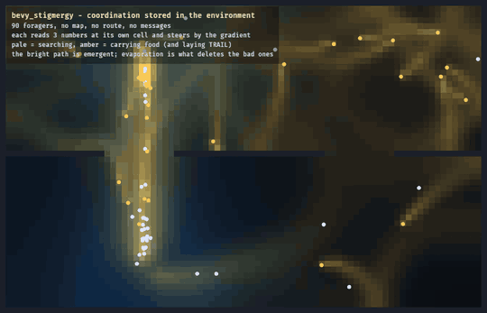

# bevy_stigmergy

> ⚠️ **Vibe Coded.** Written by AI agents working from a human's direction, covered by tests rather than a line-by-line human review. Read the code before you rely on it for something you care about.

Fading marks on a grid that a crowd coordinates through, like ant trails: for game AI that should converge, scatter or rally without any agent planning a route.

[](https://crates.io/crates/bevy_stigmergy) [](https://docs.rs/bevy_stigmergy) [](https://github.com/bevy-coven/bevy_stigmergy/actions/workflows/ci.yml) [](https://bevyengine.org) [](#who-and-licence)


*`examples/foraging.rs`: ninety foragers with no map and no route, each reading three numbers at its own cell, find the gap in the wall; the dim trails fading beside the bright one are evaporation forgetting routes that stopped paying.*

**Status:** usable · Bevy 0.20 · MSRV 1.97.1

**Why:** a stigmergy field (agents coordinating through marks they leave in the world) is computed once and shared by the whole crowd, so a hundred agents cost one grid tick instead of a hundred path searches, and this crate is only the field: no schedule, no systems and no named channels, so it fits a game's own loop.

## Quick start

```sh
cargo add bevy_stigmergy
```

```rust
use bevy_math::IVec2;
use bevy_stigmergy::{ChannelDef, StigGrid};

const SCENT: usize = 0;
const THREAT: usize = 1;

let (width, height) = (32, 32);
let floor = (0..height).flat_map(|y| (0..width).map(move |x| IVec2::new(x, y)));
let mut field = StigGrid::<2>::new(width as usize, height as usize, floor, [
    ChannelDef { evaporate: 0.4, diffuse: 0.10, deposit_radius: 1.5 }, // SCENT
    ChannelDef { evaporate: 1.2, diffuse: 0.05, deposit_radius: 3.0 }, // THREAT
]);

let cell = IVec2::new(10, 10);
field.deposit(SCENT, cell, 1.0);       // an agent marks where it stands
field.evaporate_diffuse(1.0 / 60.0);   // decay and spread, once a tick
let here = field.sample_cell(SCENT, cell);
let uphill = field.gradient_cell(SCENT, cell + IVec2::X); // which way the scent is stronger
assert!(here > 0.0 && uphill.x < 0.0);
```

## Try it

```sh
cargo run --release --example foraging
```

The GIF above. `trail` and `rally` print the field as text, with no window or GPU.



*The same run at its last frame: the trail the colony settled on.*

## What you can do

- **Lay and read scalar channels**: `N` channels that agents deposit into, which evaporate and diffuse between floor cells but never through a wall, sampled or climbed by gradient: [the field](https://github.com/bevy-coven/bevy_stigmergy/blob/main/docs/guide/model.md).
- **Track a moving target with a rally pheromone**: `RallyGrid` stores a vector per cell, so scouts can recruit others toward something that keeps moving: [the examples](https://github.com/bevy-coven/bevy_stigmergy/blob/main/docs/guide/examples.md).
- **Map world space to cells your way**: the optional `CellFrame` covers an axis-aligned area in square cells, or keep your own hex or rotated mapping: [the field](https://github.com/bevy-coven/bevy_stigmergy/blob/main/docs/guide/model.md).
- **Tick it on the thread you choose**: `evaporate_diffuse` runs inline; `evaporate_diffuse_with` hands you disjoint chunks for your own pool, bit-identical either way: [ticking the field](https://github.com/bevy-coven/bevy_stigmergy/blob/main/docs/guide/ticking.md).
- **Keep a simulation reproducible**: fixed summation order and a pure stencil make the field bit-reproducible on any thread count: [determinism](https://github.com/bevy-coven/bevy_stigmergy/blob/main/docs/guide/ticking.md#determinism).
- **Save it as data**: the `serde` and `reflect` features derive on `ChannelDef`, `RallyDef` and `CellFrame`; both are off by default.
- **Avoid the three traps** that cost the most time: [gotchas](https://github.com/bevy-coven/bevy_stigmergy/blob/main/docs/guide/gotchas.md).

## Part of the Coven

`bevy_stigmergy` is one of the [Bevy Coven](https://github.com/bevy-coven) crates: [`bevy_orca`](https://crates.io/crates/bevy_orca) crowds deposit into it and steer by it, and [`bevy_society`](https://crates.io/crates/bevy_society) keeps its villagers' presence and commotion in it. How the Cauldron, the Coven's editor, uses it is on [its page in the book](https://bevy-coven.github.io/crates/bevy_stigmergy.html#use-it-in-the-cauldron).

## Bevy compatibility

| `bevy_stigmergy` | Bevy |
|---|---|
| 0.2 | 0.20 |

## Learn more

- [docs.rs/bevy_stigmergy](https://docs.rs/bevy_stigmergy): the API.
- [The book page](https://bevy-coven.github.io/crates/bevy_stigmergy.html).
- [`docs/guide/`](https://github.com/bevy-coven/bevy_stigmergy/blob/main/docs/guide/README.md): the field, ticking, gotchas, the examples and the references.
- [`examples/`](https://github.com/bevy-coven/bevy_stigmergy/tree/main/examples) and [`CHANGELOG.md`](https://github.com/bevy-coven/bevy_stigmergy/blob/main/CHANGELOG.md).

## Who and licence

Maintained by [@Ladvien](https://github.com/Ladvien). This repository is canonical: issues and pull requests belong at [github.com/bevy-coven/bevy_stigmergy/issues](https://github.com/bevy-coven/bevy_stigmergy/issues), and contributions follow the org's [CONTRIBUTING.md](https://github.com/bevy-coven/.github/blob/main/CONTRIBUTING.md).

MIT OR Apache-2.0, at your option.
